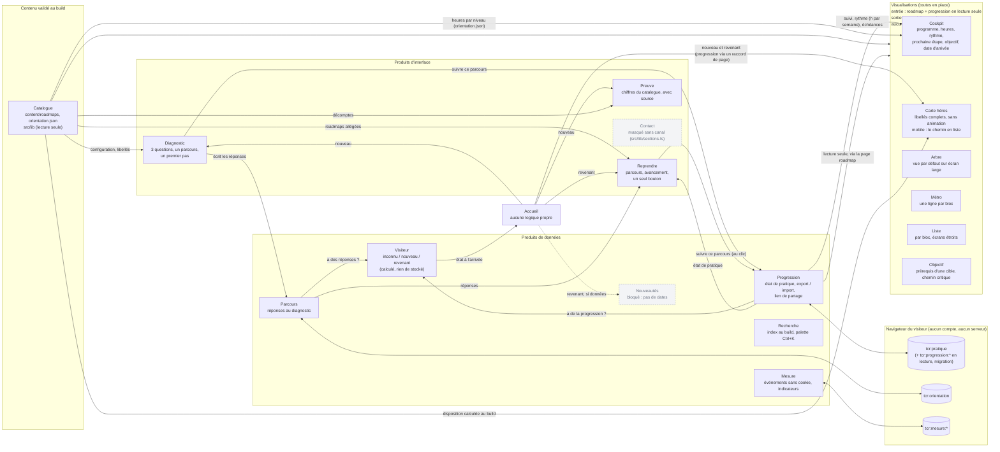
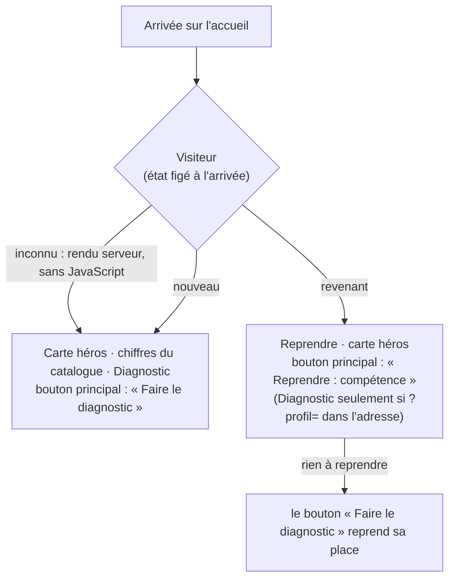

# Architecture fonctionnelle : les produits

État au 2026-11-02. Les « produits » ne sont pas des microservices déployés séparément : ce sont des modules d'une seule application Next.js, dans `src/produits/<nom>/`. Chacun ne s'utilise que par son entrée publique (`index.ts`), ce que le linter fait respecter (voir `eslint.config.mjs` et `src/produits/frontieres.test.ts`).

Règles communes :
- un produit possède ses données : lui seul lit et écrit ses clés du stockage du navigateur ;
- il se masque quand il n'a pas de donnée (jamais de contenu inventé) ;
- il a une page d'essai `/labo/<nom>` (non indexée) et ses tests.

## Schéma fonctionnel

Traits pleins : en place. Traits pointillés et blocs grisés : prévus, pas encore implémentés.

## L'accueil selon le visiteur

## Contrats

| Produit | Entrée publique | Possède | Dépend de |
|---|---|---|---|
| Progression | `usePratique`, `useProgression`, `useRythme`, `useEcheances`, `definirRythme`, fonctions pures (`compter`, `vueProgression`…), export / import, lien de partage, `aDeLaProgression` | `tcr:pratique`, `tcr:progression:*` (lecture) | Catalogue (types), `src/lib/jour.ts` |
| Parcours | `useReponsesEnregistrees`, `enregistrerReponses`, `lireReponses` | `tcr:orientation` | aucun |
| Visiteur | `useVisiteur`, `calculerVisiteur`, `<SelonVisiteur nouveau revenant>` | rien (calculé) | Progression, Parcours |
| Diagnostic | `<Diagnostic config … seulementSiPartage>`, `ANCRE_DIAGNOSTIC` | rien | Catalogue, Parcours (écrit), Progression (écrit le parcours suivi) |
| Reprendre | `<Reprendre roadmaps config sinon>`, `calculerReprise` | rien | Catalogue, Progression, Parcours |
| Liste | `<Liste roadmap selection progression chemin onOuvrir>`, `lignesParBloc` | rien ; mêmes interdits que la Carte héros | Catalogue ; progression reçue en entrée |
| Métro, Arbre, Objectif | `<CarteMetro>`, `<GrapheRoadmap>`, `<VueObjectif>` (React Flow, chargés à la demande) ; `calculerMetro`, `aretesArbre`, `syntheseObjectif` | rien ; mêmes interdits | Catalogue, `src/lib/layout.ts`, `navigation.ts`, `objectif.ts` (partagés) ; progression reçue en entrée ; Objectif émet aussi `onChoisirCible` |
| Cockpit | `<Cockpit donnees titre parNiveau onOuvrir onRythme onObjectif>`, `<Programme programme parNiveau>`, `<Rythme>`, `calculerCockpit`, `calculerProgramme`, `placerSemaines`, `projeter` | rien ; mêmes interdits que les visualisations | Catalogue, `src/lib/objectif.ts` et `duree.ts` (partagés) ; suivi, rythme, date et échéances reçus en entrée (raccord : RoadmapView, ProgrammeChoisi) |
| Preuve | `chiffresCatalogue(catalogue)` (build), `<Preuve chiffres>` | rien ; chaque chiffre porte sa source | Catalogue |
| Recherche | `construireIndex`, `rechercher`, `normaliser`, `<RecherchePalette>`, `<BoutonRecherche>` | rien | Catalogue (index servi par /index-recherche.json) |
| Consentement | `<Bandeau>`, `<LienChoix>`, `useConsentement`, `lireChoix` | `tcr:consentement` (`{ choix, jour }`, valable 6 mois) | aucun |
| Mesure | `suivre`, `suivreUnParJour`, `EVENEMENTS`, `<LienSuivi>`, `<Analytics>`, `calculerIndicateurs` | `tcr:mesure:*` | `src/lib/jour.ts` |
| Landscape | `chargerLandscape`, `resoudreLandscape` (build), `<LandscapeView landscape>` | rien | Catalogue (content/landscape.json, rôles du projet, roadmaps), Recherche (`normaliser`) |
| Inscription | `<EncartInscription action champEmail>`, `doitAfficher` | `tcr:inscription` (pages vues, fermeture, inscription) | Parcours (a choisi un parcours ?), Mesure ; affiché seulement si INSTANCE.inscription est renseigné |
| Carte héros | `disposerCarte(roadmap, cibles, { heures?, depart? })`, `choisirCible` (build), `<CarteHeros disposition progression? onOuvrir?>` | rien ; le linter lui interdit le stockage et les hooks de Progression | Catalogue ; progression reçue en entrée |

Pages d'essai : `/labo/progression`, `/labo/parcours`, `/labo/visiteur`, `/labo/diagnostic`, `/labo/reprendre`, `/labo/carte-heros`, `/labo/liste`, `/labo/metro`, `/labo/arbre`, `/labo/objectif`, `/labo/cockpit`, `/labo/consentement`, `/labo/preuve`, `/labo/recherche`, `/labo/mesure`, `/labo/landscape`.

## Prochaines étapes

1. Les cinq visualisations sont des produits ; la roadmap est restée identique (comparaison au pixel avant / après).
2. Contact : un produit dédié quand un canal existera ; d'ici là, la règle de src/lib/sections.ts masque tous les liens de contact.
3. Nouveautés : après réception des dates de publication (voir `docs/SPEC-PARCOURS-DESIGN.md`, §5).

## Après le diagnostic : la carte se redessine

- Au build, une carte par point de départ possible du diagnostic (`src/lib/cartesDeparts.ts`) : du départ à la compétence la plus avancée qui s'appuie dessus, 15 compétences au plus. Servies en fichier statique `/cartes-parcours.json` (environ 90 Ko), chargé seulement après un diagnostic.
- Raccords de page (pas des produits) : `CarteHerosSuivie` choisit la carte (réponses du produit Parcours, ou le résultat affiché) et passe la progression en lecture seule ; `DiagnosticAvecCarte` place cette carte dans le résultat du diagnostic, par la sortie `apresResultat` du produit Diagnostic.

## Rubrique Sylva (/sylva, onglet à part)

- Parcours thématique `content/roadmaps/parcours-sylva.json` (type `competence`) : 27 compétences, dont 14 propres à Sylva, rédigées à partir du dépôt sylva-core et de la documentation officielle (sources du portail sur GitLab). Il figure dans l'ordre d'affichage (compétences partagées, en dernier) mais le diagnostic ne le recommande pas : il oriente par métier.
- Données de la page `content/sylva.json`, validées au build par `src/lib/sylva.ts` : faits sourcés, fonctionnement, outils du landscape présents dans Sylva (chacun avec sa preuve : unit de sylva-core ou page de documentation), autres composants, limites.
- La page s'ouvre sur le landscape de Sylva : les composants de `content/sylva-units.json`, importés de la liste officielle de sylva-core par `scripts/importer-units-sylva.mjs` (fonction, maturité, origine SUSE d'après la source du chart), puis la pile SUSE (dépôt susetelcocloud), le projet, le fonctionnement et la Carte héros du parcours. Le parcours se régénère avec `scripts/generer-parcours-sylva.mjs`.
- Parcours à part (src/lib/rubriques.ts) : absent du catalogue des roadmaps, de la page Ressources et des décomptes « par métier » ; son parcours et ses compétences sont rattachés à l'onglet Sylva (fil d'Ariane, onglet actif) et ne proposent pas le diagnostic. /ressources/sylva redirige (301) vers /sylva.

## Cockpit de la roadmap et programme du parcours

- Page de roadmap : cockpit (où j'en suis, heures faites et restantes, rythme et date d'arrivée, prochaine étape, révisions dues, objectif et chemin critique), programme par bloc, puis la carte en détail. Raccord : `src/components/RoadmapView.tsx` lit la progression, le rythme et les échéances (produit Progression) et les passe au produit Cockpit ; une seule action principale (accent) : « Réviser » s'il y a des révisions dues, sinon « Ouvrir » la prochaine étape.
- Résultat du diagnostic : raccord `src/components/ProgrammeChoisi.tsx` (programme du parcours recommandé, rythme partagé avec le cockpit), données `/programmes.json` (route statique, `src/lib/programmes.ts`).
- Le rythme (h par semaine, défaut 4) appartient au produit Progression (`tcr:pratique`, champ `rythme`). Les heures sont l'hypothèse éditoriale de content/orientation.json : toujours « estimation indicative ».

## Consentement à la mesure d'audience

- Le site ne dépose aucun cookie. Le seul traitement soumis à choix est la mesure Vercel Web Analytics : le script (`Analytics`, produit Mesure) ne se charge qu'après « Accepter » ; sans accord, `window.va` n'existe pas et `suivre` ne fait rien.
- Bandeau en bas de page (« Refuser » et « Accepter » à égalité, non bloquant), lien « Gérer mes choix » dans le pied de page ; refuser après avoir accepté recharge la page pour décharger le script. Choix mémorisé 6 mois (`VALIDITE_JOURS`, hypothèse du site).
- Le bandeau et le lien n'existent que si la mesure existe (`mesureActive` : production, instance publique, `NEXT_PUBLIC_ANALYTICS=vercel`). Sans cette variable sur Vercel, aucun bandeau n'apparaît : il n'y aurait rien à consentir.
